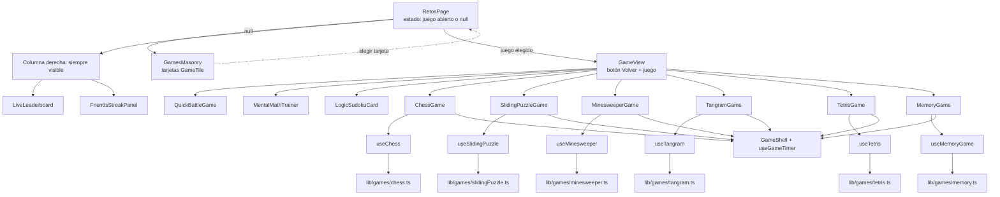

# Design Document

## Overview

Este diseño añade seis juegos a la sección **Retos** del alumno: Ajedrez, Juego del 15, Buscaminas, Tangram, Tetris y Memorama. Además cambia la entrada a Retos: ahora muestra una cuadrícula **Masonry** con todos los juegos (los seis nuevos y los tres que ya existen), y cada juego se abre y se juega por separado. Todos se ejecutan en el navegador, sin backend ni librerías nuevas. Es una función de solo frontend en `frontend/web/`, coherente con `ARCHITECTURE.md`, `DESIGN.md` y `synapz-rules.md`: TypeScript estricto sin `any`, Tailwind v4 con modo oscuro por clase `.dark`, iconos solo de `lucide-react`, sin `style={{}}` para color y sin llamadas de red.

Decisiones principales:

1. **Motor puro por juego.** Cada juego tiene un archivo en `lib/games/` con funciones puras y tipadas (sin React, sin `Date`, sin `Math.random` directo salvo vía `lib/random.ts`). La interfaz solo llama a esas funciones. Así se puede verificar cada motor con scripts de Node sin framework de pruebas, como se hizo con el sudoku.
2. **Un hook por juego** en `hooks/` que guarda el estado, los temporizadores y los listeners, y los limpia al desmontar.
3. **Entrada Masonry y juegos por separado.** Al abrir Retos se ve una cuadrícula Masonry con una tarjeta por juego. Al elegir una tarjeta, la página muestra solo ese juego, con un botón "Volver a Retos". Solo se monta el juego abierto, así que los temporizadores y los listeners de teclado de los demás no corren. Las tarjetas de la cuadrícula son estáticas y no ejecutan lógica de juego.
4. **Sin dependencias nuevas.** Ajedrez con glifos Unicode, Tangram con SVG, Tetris y Buscaminas con rejillas de `div`/`button`. Los iconos del Memorama salen de `lucide-react`.
5. **Sin persistencia.** No hay `localStorage`, ranking ni puntos para el aula. Queda fuera de alcance y se puede añadir después.
6. **Ajedrez de dos jugadores en el mismo dispositivo.** No hay IA rival. Es una decisión de alcance: la IA es un trabajo aparte.

### Supuestos a confirmar

1. Los juegos viven dentro de Retos. La entrada es una cuadrícula Masonry con los 9 juegos: Batalla rápida, Cálculo mental, Sudoku de lógica y los seis nuevos. No se añaden entradas al `Sidebar` ni se usa un enrutador (el proyecto aún no tiene `react-router`).
1b. En Retos, el ranking en vivo y el panel de rachas con puntos de la semana se ven siempre en la columna derecha, con el ranking arriba y la racha debajo, tanto con la cuadrícula como con un juego abierto.
2. El ajedrez no incluye reloj, tablas por repetición ni regla de los 50 movimientos. Sí incluye tablas por ahogado y por material insuficiente.
3. El Buscaminas tiene tres dificultades fijas, no una cuadrícula libre. "Configurable" se cumple con la dificultad.
4. El Tangram trae 4 figuras objetivo. El jugador mueve las 7 piezas con el puntero y las rota con botones.
5. No se guardan récords.

## Architecture



Flujo de navegación: `RetosPage` guarda `openGame: GameId | null`. Con `null` muestra la cuadrícula Masonry en la columna principal. Con un juego elegido muestra `GameView`. En ambos casos la columna derecha muestra el ranking y el panel de rachas. Al elegir una tarjeta guarda el id y muestra `GameView`. El botón "Volver a Retos" vuelve a `null`.

Flujo común de cada juego:

1. El hook crea el estado inicial con una función del motor (por ejemplo `createGame(difficulty)`).
2. La interfaz llama a acciones del hook (`play(...)`, `reset()`).
3. El hook aplica una función pura del motor y guarda el estado nuevo. Las transiciones inválidas devuelven la misma referencia y no provocan re-render.
4. El hook deriva el estado de la partida (`playing`, `won`, `lost`, `draw`, `checkmate`, etc.) con `useMemo`.
5. `GameShell` muestra cabecera, estado, temporizador y botón de reinicio de forma uniforme.

## Components and Interfaces

### Estructura de archivos (bajo `frontend/web/src/`)

| Archivo | Contenido |
|---|---|
| `types/games.ts` | `GameId`, `GameInfo` y tipos compartidos de la entrada a Retos. |
| `types/chess.ts`, `types/slidingPuzzle.ts`, `types/minesweeper.ts`, `types/tangram.ts`, `types/tetris.ts`, `types/memory.ts` | Tipos de cada juego (solo cliente). Un archivo por juego para que se puedan desarrollar por separado. |
| `lib/games/chess.ts` | Motor de ajedrez. |
| `lib/games/slidingPuzzle.ts` | Motor del Juego del 15. |
| `lib/games/minesweeper.ts` | Motor del Buscaminas. |
| `lib/games/tangram.ts` | Geometría, figuras y validación del Tangram. |
| `lib/games/tetris.ts` | Motor del Tetris. |
| `lib/games/memory.ts` | Motor del Memorama. |
| `hooks/useGameTimer.ts` | Cronómetro común (inicio, pausa, reinicio, limpieza). |
| `hooks/useChess.ts`, `useSlidingPuzzle.ts`, `useMinesweeper.ts`, `useTangram.ts`, `useTetris.ts`, `useMemoryGame.ts` | Estado y efectos de cada juego. |
| `lib/games/catalog.ts` | Catálogo de los 9 juegos: id, título, descripción, icono, tono, etiquetas y altura de la tarjeta. |
| `components/games/GamesMasonry.tsx` | Cuadrícula Masonry con una `GameTile` por juego. |
| `components/games/GameTile.tsx` | Tarjeta de un juego en la cuadrícula. |
| `components/games/GameView.tsx` | Vista de un juego: encabezado, botón "Volver a Retos" y el juego. |
| `components/games/GameShell.tsx` | Marco común: título, estado, temporizador, reinicio. |
| `components/games/ChessGame.tsx`, `ChessBoard.tsx`, `ChessHistory.tsx`, `PromotionPicker.tsx` | Interfaz del ajedrez. |
| `components/games/SlidingPuzzleGame.tsx` | Interfaz del 15. |
| `components/games/MinesweeperGame.tsx` | Interfaz del Buscaminas. |
| `components/games/TangramGame.tsx`, `TangramBoard.tsx` | Interfaz del Tangram. |
| `components/games/TetrisGame.tsx`, `TetrisBoard.tsx` | Interfaz del Tetris. |
| `components/games/MemoryGame.tsx` | Interfaz del Memorama. |
| `pages/RetosPage.tsx` | Guardar el juego abierto. Mostrar `GamesMasonry` con la columna derecha (ranking arriba, racha debajo) o `GameView`. Mover aquí los tres juegos existentes. |
| `frontend/web/DESIGN.md` | Nueva sección 7 con la UI de los juegos. |
| `Synapz/requirements.md`, `README.md` | Añadir los juegos a D4 y a las características. |

No cambian `ChallengeCard.tsx`, `StudentLayout.tsx`, `Sidebar.tsx` ni el código interno del Sudoku, la Batalla rápida, el Cálculo mental, `LiveLeaderboard` y `FriendsStreakPanel`. Solo cambia dónde y cuándo se muestran.

### Convenciones comunes

- Un componente por archivo, PascalCase, export nombrado y props tipadas.
- Superficies, bordes y tipografía de `DESIGN.md` §3 y §4: tarjeta `rounded-2xl border border-slate-200 bg-white dark:border-[#222B3E] dark:bg-[#131A29]`, sub-tarjeta `dark:bg-[#161E30]`, acento azul, CTA ámbar (`PRIMARY_BUTTON`) y secundarios (`SECONDARY_BUTTON`) reutilizados de `ChallengeCard.tsx`.
- Cada juego nuevo se envuelve en `ChallengeCard` con `tone`, igual que los existentes. `GameView` los muestra uno a uno.
- Estado de la partida en una región `aria-live="polite"`.
- Teclado: cada juego define sus teclas y las escucha en su contenedor con `tabIndex={0}`, no en `window`, para no interferir con el resto de la página.
- Temporizadores con `setInterval`/`setTimeout` y limpieza en el `return` del `useEffect`. Se detienen cuando la partida termina o el juego se desmonta.
- Los motores no usan `any`, no mutan sus argumentos y devuelven la misma referencia cuando una acción no cambia nada.

### Entrada a Retos: `GamesMasonry`, `GameTile` y `GameView`

**`lib/games/catalog.ts`**

```ts
export type GameId =
  | "batalla" | "calculo" | "sudoku"
  | "ajedrez" | "quince" | "buscaminas" | "tangram" | "tetris" | "memorama";

export interface GameInfo {
  id: GameId;
  title: string;
  description: string;      // una frase
  icon: LucideIcon;
  tone: ChallengeTone;      // "amber" | "blue" | "emerald" | "violet" (de ChallengeCard)
  tags: readonly string[];  // p. ej. "1 jugador", "Lógica", "Tiempo"
  height: "short" | "medium" | "tall"; // altura de la tarjeta en el Masonry
}
export const GAMES: readonly GameInfo[]; // 9 entradas
```

Orden y alturas propuestos (la mezcla de alturas hace visible el Masonry):

| Juego | Altura | Tono | Etiquetas |
|---|---|---|---|
| Batalla rápida | medium | amber | Contra reloj, Ranking |
| Cálculo mental | short | blue | Matemáticas |
| Sudoku de lógica | tall | emerald | Lógica |
| Ajedrez | tall | violet | 2 jugadores, Estrategia |
| Juego del 15 | short | blue | Lógica |
| Buscaminas | medium | emerald | Lógica, Tiempo |
| Tangram | tall | amber | Geometría |
| Tetris | medium | violet | Reflejos |
| Memorama | short | amber | Memoria |

**`GamesMasonry`**

- Layout Masonry con **columnas CSS** de Tailwind: contenedor `columns-1 gap-4 sm:columns-2 xl:columns-3 md:gap-5` y cada tarjeta con `mb-4 break-inside-avoid md:mb-5`. No se añade ninguna librería. Las tarjetas se reparten en columnas de arriba hacia abajo, así que el orden de lectura sigue la columna y no la fila. Para que el orden de tabulación sea el visual, cada tarjeta es un `<button>` en el orden del catálogo.
- Responsive: 1 columna en móvil, 2 desde `sm`, 3 desde `xl`. Sin scroll horizontal a 320 px.
- Contenedor con `role="list"` y cada tarjeta en un `role="listitem"`. Título de sección "Elige un juego".

**`GameTile`**

```ts
interface GameTileProps { game: GameInfo; onOpen: (id: GameId) => void }
```

Tarjeta con el estilo de `ChallengeCard` (`rounded-2xl border bg-white p-5 shadow-sm`, y variantes `dark:`). Contiene el icono en un cuadro del tono, el título, la descripción, las etiquetas como chips y un botón "Jugar" con `ArrowRight`. La altura se obtiene del contenido: `short` muestra solo lo anterior, `medium` añade una vista previa decorativa pequeña y `tall` una vista previa grande. Las vistas previas son figuras estáticas hechas con elementos de Tailwind y `aria-hidden` (por ejemplo, una mini rejilla de ajedrez o de sudoku), sin lógica de juego ni temporizadores. Toda la tarjeta es clicable con foco visible (`focus-visible:ring-2 focus-visible:ring-blue-500`), `hover` suave y `aria-label="Jugar a {título}"`.

**`GameView`**

```ts
interface GameViewProps { game: GameInfo; onBack: () => void; children: ReactNode }
```

Encabezado con el botón "Volver a Retos" (`ArrowLeft`, `SECONDARY_BUTTON`), el título del juego y el contenido del juego. Al abrirse, el foco pasa al título (`tabIndex={-1}`). Al volver, el foco regresa a la tarjeta que se abrió. `RetosPage` conserva el id del último juego abierto para eso.

**`pages/RetosPage.tsx`**

```ts
const [openGame, setOpenGame] = useState<GameId | null>(null);
const leaderboard = useLeaderboard(MOCK_CLASSROOM_ID); // se queda en RetosPage
```

Layout de dos columnas `lg:grid-cols-[minmax(0,1fr)_18rem]` para ambas vistas:

- **Columna principal:** la cuadrícula Masonry (`openGame === null`) o `GameView` con el juego abierto.
- **Columna derecha** (`lg:sticky lg:top-6 lg:self-start`, `flex flex-col gap-4 md:gap-5`), siempre visible y en este orden de arriba abajo:
  1. `LiveLeaderboard` con `entries={leaderboard}`: el ranking del aula.
  2. `FriendsStreakPanel` con la racha y los puntos de la semana, igual que hoy.
- En pantallas menores a `lg`, la columna derecha pasa debajo del contenido principal, con el mismo orden: ranking y luego racha.
- Los tableros deben caber en la columna principal, que a ancho `lg` mide el contenedor (máx. 6xl) menos 18 rem. Cada juego dimensiona su tablero con un ancho máximo propio y se centra.
- La Batalla rápida ya no lleva el ranking a su lado, porque el ranking tiene su lugar fijo. Como `useLeaderboard` se queda en `RetosPage`, el ranking conserva las actualizaciones en vivo de la partida de Batalla rápida mientras se juega.

Notas:

- El estado de `openGame` vive en `RetosPage`. Si el alumno cambia de pestaña y vuelve, Retos empieza otra vez en la cuadrícula. No se guarda en `localStorage` ni en la URL.
- Un `Record<GameId, ReactNode>` o un `switch` exhaustivo decide qué componente montar. TypeScript marca un error si falta algún id.
- `LiveLeaderboard` y `FriendsStreakPanel` no cambian por dentro.

### `components/games/GameShell.tsx`

```ts
interface GameShellProps {
  status: string;            // texto para aria-live
  tone: "neutral" | "success" | "danger";
  elapsed?: number;          // segundos; si falta, no se muestra reloj
  stats?: readonly { label: string; value: string }[];
  onReset: () => void;
  resetLabel?: string;       // por defecto "Reiniciar"
  children: ReactNode;
}
```

Muestra la fila de estadísticas, la región de estado con colores (`neutral`, `success`, `danger`) y el botón de reinicio (`SECONDARY_BUTTON`, pasa a `PRIMARY_BUTTON` al terminar la partida).

### `hooks/useGameTimer.ts`

```ts
export function useGameTimer(running: boolean): { elapsed: number; reset: () => void };
```

Cuenta segundos con `setInterval` de 1 s mientras `running`. `reset` vuelve a 0.

### 1. Ajedrez

**`lib/games/chess.ts`**

```ts
export type Color = "w" | "b";
export type PieceType = "p" | "n" | "b" | "r" | "q" | "k";
export interface Piece { color: Color; type: PieceType }
export type Square = number; // 0..63, 0 = a8, 63 = h1

export interface ChessState {
  board: readonly (Piece | null)[];   // 64
  turn: Color;
  castling: { wK: boolean; wQ: boolean; bK: boolean; bQ: boolean };
  enPassant: Square | null;           // casilla de destino de la captura al paso
  halfmove: number;
  history: readonly MoveRecord[];
}
export interface Move {
  from: Square; to: Square;
  promotion?: Exclude<PieceType, "p" | "k">;
}
export interface MoveRecord { move: Move; san: string; captured: PieceType | null }
export type ChessStatus =
  | { kind: "playing"; check: boolean }
  | { kind: "checkmate"; winner: Color }
  | { kind: "stalemate" }
  | { kind: "draw-material" };

export function initialState(): ChessState;
export function legalMoves(state: ChessState, from?: Square): Move[];
export function applyMove(state: ChessState, move: Move): ChessState; // lanza si es ilegal
export function statusOf(state: ChessState): ChessStatus;
export function isInCheck(state: ChessState, color: Color): boolean;
export function toSan(state: ChessState, move: Move): string; // antes de aplicar
```

Reglas del motor:

- Generación pseudo-legal por pieza y filtro por seguridad del rey (se aplica el movimiento en una copia y se comprueba que el rey propio no queda atacado). Es lo bastante rápido para un tablero de 8×8.
- **Enroque:** solo si el rey y la torre no se han movido (derechos en `castling`), las casillas entre ambos están vacías, el rey no está en jaque y no cruza ni termina en casillas atacadas. Se codifica como el movimiento del rey de dos columnas.
- **Captura al paso:** `enPassant` se fija tras un avance doble de peón y se limpia en el movimiento siguiente. El peón capturado se retira de su casilla real.
- **Promoción:** un peón que llega a la última fila genera cuatro movimientos legales (dama, torre, alfil, caballo). La interfaz pide la pieza antes de aplicar.
- **Estado:** sin movimientos legales y en jaque es jaque mate; sin movimientos legales y sin jaque es ahogado; rey contra rey, rey y un alfil o un caballo contra rey, o alfiles del mismo color de casilla, es tablas por material insuficiente.
- **Historial:** `toSan` produce notación algebraica (`e4`, `Nf3`, `exd5`, `O-O`, `e8=Q`, con `+` y `#`), con desambiguación cuando dos piezas iguales pueden ir a la misma casilla.

**Interfaz.** `ChessBoard` muestra un tablero de 8×8 con casillas claras y oscuras (`bg-amber-100`/`bg-amber-700` en claro, equivalentes más oscuros en modo oscuro), piezas con glifos Unicode (`♔♕♖♗♘♙` para blancas y `♚♛♜♝♞♟` para negras, con relleno y contorno por color), coordenadas, resaltado de la casilla seleccionada, puntos en los destinos legales, y marca del rey en jaque. Toque en una pieza propia selecciona; toque en un destino legal mueve; toque en otra pieza propia cambia la selección. `PromotionPicker` es un diálogo en línea con cuatro botones. `ChessHistory` lista los movimientos en dos columnas (blancas y negras) y se desplaza al último. Estado visible: de quién es el turno, "Jaque", "Jaque mate: ganan blancas", "Tablas por ahogado". Botón "Nueva partida". Con la partida terminada, el tablero no acepta movimientos.

Teclado: el contenedor tiene foco; cada casilla es un `button` con `aria-label` ("e2, peón blanco"), así que se opera con Tab, Enter y Espacio.

### 2. Juego del 15

**`lib/games/slidingPuzzle.ts`**

```ts
export const N = 4;
export type SlideBoard = readonly number[]; // 16 valores; 0 = hueco
export function solvedBoard(): SlideBoard;
export function isSolved(board: SlideBoard): boolean;
export function isSolvable(board: SlideBoard): boolean; // paridad de inversiones
export function shuffledBoard(): SlideBoard;             // resoluble y distinto del resuelto
export function canMove(board: SlideBoard, index: number): boolean;
export function moveTile(board: SlideBoard, index: number): SlideBoard;
export function moveByDirection(board: SlideBoard, dir: "up" | "down" | "left" | "right"): SlideBoard;
```

`shuffledBoard` parte del tablero resuelto y aplica entre 200 y 300 movimientos aleatorios válidos, sin deshacer el anterior, y repite si queda resuelto. Esto garantiza que sea resoluble. `isSolvable` se usa solo para verificar la propiedad: con un ancho par, un tablero es resoluble si la suma de las inversiones y la fila del hueco contada desde abajo (empezando en 1) es impar.

Interfaz: rejilla 4×4 de `button`. Una ficha es movible si está en la fila o la columna adyacente al hueco, a distancia 1 (solo fichas adyacentes, como en el clásico). Contador de movimientos y cronómetro desde el primer movimiento. Flechas del teclado mueven la ficha que quedaría en esa dirección. Al ganar: mensaje con movimientos y tiempo.

### 3. Buscaminas

**`lib/games/minesweeper.ts`**

```ts
export type MineDifficulty = "facil" | "medio" | "dificil";
export const MINE_LEVELS: Record<MineDifficulty, { rows: number; cols: number; mines: number }> = {
  facil:   { rows: 8,  cols: 8,  mines: 10 },
  medio:   { rows: 10, cols: 10, mines: 20 },
  dificil: { rows: 12, cols: 12, mines: 30 },
};
export interface MineCell { mine: boolean; adjacent: number; revealed: boolean; flagged: boolean }
export interface MineState {
  rows: number; cols: number; mines: number;
  cells: readonly MineCell[];
  status: "ready" | "playing" | "won" | "lost";
  revealedCount: number;
  flags: number;
  explodedIndex: number | null;
}
export function createMineState(difficulty: MineDifficulty): MineState;
export function reveal(state: MineState, index: number): MineState;
export function toggleFlag(state: MineState, index: number): MineState;
export function chord(state: MineState, index: number): MineState; // opcional, sobre un número satisfecho
```

- **Primer clic seguro.** Las minas se colocan en el primer `reveal`, excluyendo esa casilla y sus vecinas, y se calcula `adjacent`.
- **Expansión.** Revelar una casilla con `adjacent === 0` revela sus vecinas de forma iterativa (cola, sin recursión) y sigue por las vacías. No se revelan las casillas con bandera.
- **Derrota.** Revelar una mina fija `lost` y `explodedIndex`. La interfaz muestra todas las minas y marca las banderas erróneas.
- **Victoria.** Se gana cuando `revealedCount === rows * cols - mines`. Al ganar se ponen banderas automáticas en las minas restantes.
- **Banderas.** Solo en casillas no reveladas. Contador de minas restantes `mines - flags`, que puede ser negativo.

Interfaz: selector de dificultad, rejilla de `button`, contador de minas, cronómetro desde el primer clic. Clic izquierdo revela; clic derecho (`onContextMenu` con `preventDefault`) o el **modo bandera** (botón de alternancia, para pantallas táctiles) coloca bandera. Números de 1 a 8 con colores distintos y legibles en ambos temas, y una forma además del color para banderas (`Flag`) y minas (`Bomb`).

### 4. Tangram

**`lib/games/tangram.ts`**

Geometría en unidades donde el cuadrado completo mide 4×4. Las piezas son polígonos en su sistema local, con el origen en su centro:

| Pieza | Cantidad | Forma |
|---|---|---|
| Triángulo grande | 2 | Rectángulo isósceles, catetos 2√2 |
| Triángulo mediano | 1 | Rectángulo isósceles, catetos 2 |
| Triángulo pequeño | 2 | Rectángulo isósceles, catetos √2 |
| Cuadrado | 1 | Lado √2 |
| Paralelogramo | 1 | Lados √2 y 2, ángulos de 45° y 135° |

```ts
export type TanKind = "large" | "medium" | "small" | "square" | "parallelogram";
export interface Point { x: number; y: number }
export interface TanPlacement {
  id: string;            // "large-1", "small-2", ...
  kind: TanKind;
  x: number; y: number;  // posición del centro
  rotation: number;      // múltiplos de 45°, 0..315
  flipped: boolean;      // solo el paralelogramo
}
export interface TangramFigure {
  id: string; name: string;
  solution: readonly TanPlacement[]; // 7 colocaciones
}

export function polygonOf(p: TanPlacement): Point[];            // vértices en coordenadas del tablero
export function snap(p: TanPlacement, step?: number): TanPlacement; // ajusta x e y a la rejilla (0.25)
export function matchPieces(placed: readonly TanPlacement[], figure: TangramFigure, tolerance?: number): Set<string>; // ids bien colocados
export function isFigureComplete(placed: readonly TanPlacement[], figure: TangramFigure): boolean;
export const FIGURES: readonly TangramFigure[];
export function initialLayout(): TanPlacement[]; // las 7 piezas dispersas en el área de reserva
```

**Validación.** Una pieza coincide con un hueco de la silueta si es del mismo tipo y el conjunto de vértices de su polígono coincide con el del hueco dentro de una tolerancia (por defecto 0.2 unidades), sin importar el orden de los vértices. Comparar el conjunto de vértices resuelve las simetrías sin casos especiales: el cuadrado girado 90° da el mismo conjunto, y el paralelogramo volteado da otro, por lo que debe voltearse. Las piezas del mismo tipo (dos grandes, dos pequeñas) son intercambiables: se asignan con un emparejamiento voraz por tipo. La figura está completa cuando las 7 piezas coinciden.

**Figuras.** Al menos 4: cuadrado, triángulo grande, casa y gato (o similar). Cada una se define con las 7 colocaciones de su solución. Un script de verificación comprueba, para cada figura, que las áreas suman 16 (el área total del tangram: 4 + 4 + 2 + 1 + 1 + 2 + 2) y que ningún par de piezas de la solución se solapa. Las coordenadas exactas de cada figura las calcula la implementación a partir de las reglas anteriores y se validan con ese script antes de aceptarlas.

**Interfaz.** `TangramBoard` es un `<svg viewBox>` que contiene la silueta objetivo (polígonos en gris) y las 7 piezas (cada una con su color: azul, verde, amarillo, naranja, rosa, violeta, cian, con clases de Tailwind `fill-*`/`stroke-*` en modo claro y oscuro). Se arrastra con Pointer Events (`onPointerDown/Move/Up` con `setPointerCapture`), convirtiendo coordenadas de pantalla a unidades del SVG con `getScreenCTM()`. Al soltar, la pieza se ajusta a la rejilla. La pieza seleccionada se rota con los botones "↺ 45°" y "↻ 45°" (y con las teclas `Q`/`E`), y el paralelogramo se voltea con el botón "Voltear". Las piezas bien colocadas se resaltan con borde verde. Selector de figura, botón "Reiniciar figura" y mensaje de éxito cuando está completa. Las piezas también se mueven con las flechas del teclado en pasos de 0.25 cuando están seleccionadas (accesibilidad).

### 5. Tetris

**`lib/games/tetris.ts`**

```ts
export const COLS = 10;
export const ROWS = 20;
export type TetrominoKind = "I" | "O" | "T" | "S" | "Z" | "J" | "L";
export interface ActivePiece { kind: TetrominoKind; rotation: 0 | 1 | 2 | 3; row: number; col: number }
export interface TetrisState {
  board: readonly (TetrominoKind | null)[];   // ROWS * COLS
  active: ActivePiece;
  next: readonly TetrominoKind[];             // cola; la bolsa se rellena
  score: number; lines: number; level: number;
  status: "playing" | "paused" | "over";
}
export function createTetris(): TetrisState;
export function shapeOf(kind: TetrominoKind, rotation: number): readonly (readonly [number, number])[]; // 4 celdas
export function collides(board: TetrisState["board"], piece: ActivePiece): boolean;
export function moveHorizontal(state: TetrisState, dir: -1 | 1): TetrisState;
export function rotate(state: TetrisState, dir: 1 | -1): TetrisState;  // con pruebas de pared simples
export function softDrop(state: TetrisState): TetrisState;             // baja una fila; si no puede, fija
export function hardDrop(state: TetrisState): TetrisState;             // baja hasta el fondo y fija
export function tick(state: TetrisState): TetrisState;                  // gravedad
export function ghostRow(state: TetrisState): number;
export function dropIntervalMs(level: number): number;
export function togglePause(state: TetrisState): TetrisState;
```

- **Piezas** con sus cuatro rotaciones como tablas fijas (sistema SRS). La rotación prueba el desplazamiento nulo y luego desplazamientos horizontales de ±1 y ±2 (patada de pared simple) y se rechaza si todos colisionan.
- **Aparición.** Las piezas salen de una "bolsa de 7" mezclada con `shuffle`, que se rellena cuando queda vacía. Si la pieza nueva colisiona al aparecer, el juego termina.
- **Fijado y líneas.** Al fijar una pieza se copia al tablero y se eliminan las filas completas, bajando las de arriba.
- **Puntuación.** 100, 300, 500 y 800 puntos por 1, 2, 3 y 4 líneas, multiplicados por el nivel. Caída suave suma 1 punto por fila y caída rápida suma 2 por fila.
- **Nivel.** Sube cada 10 líneas (`level = 1 + floor(lines / 10)`). Intervalo de caída: `max(100, 800 - (level - 1) * 70)` ms.
- **Fin de partida.** Estado `over` cuando la pieza nueva colisiona. El tablero queda visible con el mensaje y el botón de reinicio.

**Hook `useTetris`.** Un `setInterval` reprogramado cuando cambia el nivel, que llama a `tick` mientras `status === "playing"`. Un `onKeyDown` en el contenedor con foco: ← → mueven, ↓ caída suave, ↑ o `X` rotar, `Z` rotar al revés, Espacio caída rápida, `P` pausa. Se llama a `preventDefault` en esas teclas para que la página no se desplace. Para pantallas táctiles, una botonera con los mismos controles.

**Interfaz.** `TetrisBoard` dibuja el tablero 10×20 con celdas por color de pieza (clases `bg-*` estáticas), la pieza activa, la sombra de caída (`ghostRow`) con borde punteado y una vista previa de las siguientes dos piezas. Panel con puntuación, líneas y nivel.

### 6. Memorama

**`lib/games/memory.ts`**

```ts
export type MemoryDifficulty = "facil" | "medio" | "dificil";
export const MEMORY_LEVELS: Record<MemoryDifficulty, { rows: number; cols: number }> = {
  facil:   { rows: 3, cols: 4 },  // 6 pares
  medio:   { rows: 4, cols: 4 },  // 8 pares
  dificil: { rows: 4, cols: 6 },  // 12 pares
};
export interface MemoryCard { id: number; symbol: number; faceUp: boolean; matched: boolean }
export interface MemoryState {
  cards: readonly MemoryCard[];
  firstPick: number | null;
  secondPick: number | null;   // no nulo mientras se espera para ocultar el par fallido
  attempts: number;
  pairsFound: number;
  totalPairs: number;
  status: "playing" | "won";
}
export function createMemory(difficulty: MemoryDifficulty): MemoryState;
export function flip(state: MemoryState, index: number): MemoryState;
export function resolveMismatch(state: MemoryState): MemoryState; // oculta el par fallido
export function isLocked(state: MemoryState): boolean;             // true si hay dos cartas boca arriba sin resolver
```

- **Baraja.** `createMemory` crea cada símbolo dos veces y mezcla con `shuffle`.
- **Volteo.** `flip` ignora cartas ya boca arriba, ya emparejadas o cuando `isLocked`. Al voltear la segunda carta se suma un intento. Si los símbolos coinciden, ambas pasan a `matched` y suman un par. Si no, el estado queda bloqueado.
- **Bloqueo temporal.** El hook programa `setTimeout(resolveMismatch, 900)` cuando hay un par fallido. Mientras tanto no se aceptan volteos. El timeout se cancela al reiniciar o desmontar.
- **Victoria.** `pairsFound === totalPairs`.

Interfaz: rejilla de cartas (`button`) con animación de giro por transición de `rotate-y` en Tailwind, sin librerías, y `motion-reduce:transition-none`. Cada símbolo es un icono de `lucide-react` con color propio (12 combinaciones icono-color: `Star`, `Heart`, `Moon`, `Sun`, `Cloud`, `Flame`, `Leaf`, `Bell`, `Key`, `Gem`, `Music`, `Rocket`). Contador de intentos y de pares encontrados, cronómetro desde el primer volteo, selector de dificultad, botón de reinicio.

## Data Models

Todo vive en memoria. Los tipos de cada motor se listan arriba y viven en `types/<juego>.ts`, que el motor, el hook y la interfaz importan. Ningún estado se serializa.

## Correctness Properties

Propiedades que deben cumplir los motores. Se verifican con scripts temporales de Node (sin añadir archivos ni dependencias al repo).

### Property 1: Ajedrez, conteo de movimientos (perft)

Desde la posición inicial, `perft(1) = 20`, `perft(2) = 400`, `perft(3) = 8902` y `perft(4) = 197281`. Desde la posición "Kiwipete" (`r3k2r/p1ppqpb1/bn2pnp1/3PN3/1p2P3/2N2Q1p/PPPBBPPP/R3K2R w KQkq -`), `perft(1) = 48`, `perft(2) = 2039` y `perft(3) = 97862`. Estos números cubren enroque, captura al paso, promoción y clavadas.

**Validates: Requirements 2.2, 2.3, 2.4, 2.5**

### Property 2: Ajedrez, seguridad del rey

Ningún movimiento de `legalMoves` deja al rey propio en jaque.

**Validates: Requirements 2.2**

### Property 3: Ajedrez, fin de partida

El mate del pastor (`e4 e5 Qh5 Nc6 Bc4 Nf6 Qxf7#`) produce `checkmate` con ganador blancas. Una posición de ahogado conocida (`7k/5Q2/6K1/8/8/8/8/8 b - -`) produce `stalemate`. Rey contra rey produce `draw-material`.

**Validates: Requirements 2.7, 2.8**

### Property 4: Ajedrez, enroque

El enroque no se genera si el rey está en jaque, si cruza o termina en una casilla atacada, si las casillas intermedias están ocupadas o si el rey o la torre ya se movieron.

**Validates: Requirements 2.3**

### Property 5: Ajedrez, captura al paso

Solo es legal en el turno inmediato siguiente al avance doble del peón adversario y retira el peón correcto.

**Validates: Requirements 2.4**

### Property 6: Juego del 15, tableros resolubles

Todo tablero de `shuffledBoard()` cumple `isSolvable`, no está resuelto, contiene cada valor de 0 a 15 exactamente una vez, y `moveTile` solo mueve fichas adyacentes al hueco.

**Validates: Requirements 3.2, 3.3**

### Property 7: Juego del 15, movimientos reversibles

Mover una ficha y luego mover la ficha que ocupa ahora la casilla original del hueco devuelve el tablero original.

**Validates: Requirements 3.3**

### Property 8: Buscaminas, primer clic seguro

Para cualquier casilla del primer `reveal`, esa casilla y sus vecinas no tienen mina y el número total de minas es el de la dificultad.

**Validates: Requirements 4.2**

### Property 9: Buscaminas, expansión

Revelar una casilla con `adjacent === 0` revela todas las casillas conectadas con ceros y sus bordes numéricos, y ninguna mina ni casilla con bandera.

**Validates: Requirements 4.3**

### Property 10: Buscaminas, fin de partida

`won` se alcanza si y solo si todas las casillas sin mina están reveladas. Revelar una mina da `lost`.

**Validates: Requirements 4.6, 4.7**

### Property 11: Tangram, figuras válidas

Para cada figura de `FIGURES`, las 7 piezas de la solución suman el área total (16), no se solapan y `isFigureComplete(solution, figure)` es verdadero.

**Validates: Requirements 5.2, 5.5**

### Property 12: Tangram, simetrías

Rotar el cuadrado 90° mantiene la coincidencia. Voltear el paralelogramo la rompe. Intercambiar las dos piezas grandes (o las dos pequeñas) mantiene la coincidencia.

**Validates: Requirements 5.4, 5.5**

### Property 13: Tetris, límites y colisión

Ninguna acción deja una celda de la pieza activa fuera del tablero o sobre una celda ocupada. `rotate` y `moveHorizontal` devuelven el mismo estado si colisionarían.

**Validates: Requirements 6.3, 6.4**

### Property 14: Tetris, líneas

Al fijar una pieza, cada fila completa se elimina, las filas superiores bajan, el número de celdas ocupadas disminuye en `10 × líneas` y la puntuación suma la tabla por nivel.

**Validates: Requirements 6.6, 6.7**

### Property 15: Tetris, bolsa y fin

Cada 7 piezas generadas consecutivas de una bolsa contienen cada tetrominó exactamente una vez. Si la pieza nueva colisiona al aparecer, el estado es `over` y las acciones no tienen efecto.

**Validates: Requirements 6.1, 6.8**

### Property 16: Memorama, baraja

`createMemory` crea exactamente dos cartas por símbolo. Con `isLocked` verdadero, `flip` no cambia el estado.

**Validates: Requirements 7.1, 7.5**

### Property 17: Memorama, pares e intentos

Voltear dos cartas con el mismo símbolo las deja `matched`, suma un par y un intento. Si difieren, suma un intento y `resolveMismatch` las vuelve boca abajo sin cambiar `pairsFound`. `status` es `won` si y solo si `pairsFound === totalPairs`.

**Validates: Requirements 7.2, 7.3, 7.4, 7.7**

### Property 18: Catálogo completo

`GAMES` contiene exactamente 9 entradas con ids únicos, y cada id tiene un componente asignado en `RetosPage`. La cuadrícula muestra una tarjeta por entrada, en el orden del catálogo.

**Validates: Requirements 1.1**

### Property 19: Un solo juego montado

Con `openGame === null` no hay ningún juego montado. Con `openGame = X` solo está montado el juego X. Volver a la cuadrícula desmonta el juego y limpia sus temporizadores y listeners.

**Validates: Requirements 1.5, 1.6**

### Property 20: Columna derecha de Retos

Con `openGame === null`, la columna derecha contiene `LiveLeaderboard` antes que `FriendsStreakPanel` en el orden del DOM y en el orden visual. Con un juego abierto, la columna sigue renderizándose.

**Validates: Requirements 1.2**

## Error Handling

- **Acciones inválidas.** Movimiento ilegal de ajedrez, ficha no adyacente, casilla ya revelada, carta ya emparejada, rotación bloqueada: los motores devuelven la misma referencia o descartan la acción. `applyMove` del ajedrez es la excepción: lanza `Error` si el movimiento no está en `legalMoves`, porque la interfaz solo debe llamarlo con movimientos legales.
- **Partida terminada.** Las acciones sobre partidas en `won`, `lost`, `over`, `checkmate`, `stalemate` o tablas se ignoran.
- **Temporizadores.** Todo `setInterval` y `setTimeout` se limpia al desmontar, reiniciar o cambiar de juego, para evitar fugas y avisos de React.
- **Eventos del navegador.** `contextmenu` en el Buscaminas, y teclas de flecha y Espacio en Tetris y en el 15, usan `preventDefault` solo dentro del contenedor del juego. El Tangram usa `setPointerCapture` y libera al soltar o cancelar (`onPointerCancel`).
- **Consola limpia.** Sin `console.log`, sin claves duplicadas en listas y sin actualizaciones de estado tras el desmontaje.

## Testing Strategy

El repo no tiene framework de pruebas y añadir uno queda fuera del alcance. Verificación:

1. **Compilación y lint:** `pnpm build` y `pnpm lint` sin errores al terminar cada juego.
2. **Motores con scripts temporales** (Node 22 con `--experimental-strip-types`, en `/tmp`, sin archivos nuevos en el repo): propiedades 1 a 17. En especial el perft del ajedrez y las posiciones de mate, ahogado y enroque, que son el mayor riesgo de error.
3. **Revisión por código** de los hooks: limpieza de temporizadores, listeners y estados derivados.
4. **Revisión manual en navegador** (modo claro y oscuro, y 320 px de ancho), por juego:
   - Ajedrez: jugar un mate corto, un enroque a cada lado, una captura al paso y una promoción.
   - Juego del 15: mover fichas, ver contador y reloj, resolverlo desde un tablero casi resuelto.
   - Buscaminas: primer clic con expansión, banderas con clic derecho y con el modo bandera, perder y ganar en fácil.
   - Tangram: arrastrar, rotar, voltear el paralelogramo y completar la figura más simple.
   - Tetris: mover, rotar, caída rápida, limpiar una línea, subir de nivel y perder.
   - Memorama: pares correctos, par fallido con bloqueo, victoria y reinicio.
   - Los tres juegos que ya existían (Batalla rápida con su ranking, Cálculo mental y Sudoku) se abren y funcionan igual que antes desde su tarjeta.
5. **Entrada Masonry:** al abrir Retos se ven, a la derecha, el ranking arriba y la racha con los puntos de la semana debajo, y siguen visibles con cualquier juego abierto. En la misma vista se ven los 9 juegos en cuadrícula Masonry (1, 2 y 3 columnas según el ancho, sin scroll horizontal a 320 px). Elegir una tarjeta abre solo ese juego. "Volver a Retos" regresa a la cuadrícula, devuelve el foco a la tarjeta y no deja ningún temporizador ni listener activo del juego cerrado.
