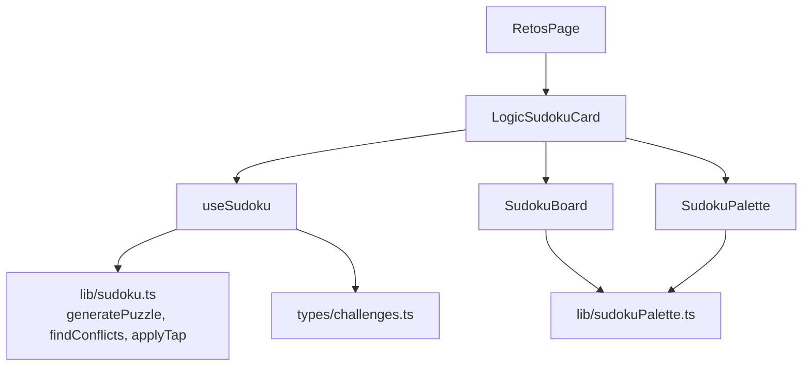

# Design Document

## Overview

El diseño reemplaza el "Sudoku de lógica" de `Retos` por un Sudoku 9×9 con mecánica de número activo. El jugador elige un número en la paleta inferior y después toca casillas para colocar o borrar ese número. Las casillas empiezan en blanco. Las que contienen el número activo se marcan en gris claro. Cuando el número activo está completo (sus 9 casillas correctas), se pintan con el color de ese número en lugar del gris. El color solo se ve mientras ese número está seleccionado.

Decisiones principales:

1. **Un solo tamaño.** Se elimina todo lo relacionado con 6×6. Como el tablero ya no varía, la geometría (9 filas, 9 columnas, bloques de 3×3) pasa a constantes y deja de viajar en el objeto `SudokuPuzzle`.
2. **Se quita la "celda seleccionada".** Hoy el estado tiene una celda seleccionada y un teclado que escribe en ella. Con el número activo ya no hace falta. El nuevo estado clave es `activeDigit: SudokuDigit | null`.
3. **Regla de toque en una función pura.** `applyTap` decide el nuevo valor de una casilla a partir del número activo. Así se puede razonar y revisar sin React.
4. **Colores en un único archivo de constantes** (`lib/sudokuPalette.ts`) con clases estáticas de Tailwind, como exige `DESIGN.md` para las materias (`lib/subjects.ts`). Tailwind v4 solo genera las clases que aparecen completas en el código, por eso no se construyen con plantillas de texto.
5. **Reutilizar el generador existente.** `generatePuzzle` ya produce soluciones únicas. Solo se simplifica quitando el parámetro de tamaño.
6. **Sin dependencias nuevas.** El repo no tiene framework de pruebas. Se verifica con `pnpm build`, `pnpm lint` y una revisión manual (ver Testing Strategy).

## Architecture



Flujo de una jugada:

1. El jugador pulsa el botón del número N. `useSudoku.toggleDigit(N)` fija `activeDigit = N`, o `null` si ya era N.
2. El jugador toca la casilla `i`. `SudokuBoard` llama a `onCellTap(i)`.
3. `useSudoku.tapCell(i)` llama a `applyTap(values, puzzle.cells, i, activeDigit)` y guarda el resultado.
4. `conflicts` y `solved` se recalculan con `useMemo` y se pasan a la UI.
5. `SudokuBoard` pinta cada casilla según tres datos: si es pista, si coincide con `activeDigit` y si está en conflicto.

Orden de implementación. El primer paso es quitar 6×6, antes de añadir comportamiento nuevo, para que cada paso compile por separado.

## Components and Interfaces

### Cambios por archivo (todos bajo `frontend/web/src/`)

| Archivo | Acción |
|---|---|
| `types/challenges.ts` | Quitar `SudokuSize` y `SudokuGeometry`. Añadir `SudokuDigit`. Simplificar `SudokuPuzzle`. |
| `lib/sudoku.ts` | Quitar `SIZES`, `CLUES[6]` y `geometryFor`. Fijar 9×9. Añadir `applyTap`. |
| `lib/sudokuPalette.ts` | Nuevo. Mapa de los 9 colores y el gris de selección `SELECTED_CELL`. |
| `hooks/useSudoku.ts` | Reescribir con `activeDigit`. Quitar celda seleccionada, `changeSize` y `moveSelection`. |
| `components/challenges/SudokuBoard.tsx` | Reescribir: tablero 9×9, resaltado, conflictos y foco con flechas. |
| `components/challenges/SudokuPalette.tsx` | Nuevo. Botones 1 a 9. |
| `components/challenges/LogicSudokuCard.tsx` | Quitar selector de tamaño y botón de borrar. Usar la paleta. Texto "Nueva partida". |
| `frontend/web/DESIGN.md` | Nueva sección con la paleta del Sudoku. |
| `requirements.md` (raíz) | D4 CA5: cambiar "6x6 y 9x9" por "9x9". |

No cambian `RetosPage.tsx`, `ChallengeCard.tsx` ni `lib/random.ts`.

### `lib/sudoku.ts`

```ts
export const SIZE = 9;
export const BOX = 3;
export const DIFFICULTIES: readonly { id: SudokuDifficulty; label: string }[]; // sin cambios

const CLUES: Record<SudokuDifficulty, number> = { facil: 42, medio: 34, dificil: 28 };

export function generatePuzzle(difficulty: SudokuDifficulty): SudokuPuzzle;
export function findConflicts(values: readonly number[]): Set<number>;
export function formatTime(totalSeconds: number): string; // sin cambios

/** Dígitos cuyas 9 casillas de la solución están llenas con ese dígito. */
export function completedDigits(values: readonly number[], solution: readonly number[]): ReadonlySet<SudokuDigit>;

/**
 * Nuevo valor de una casilla tras un toque. Devuelve `values` sin cambios (misma referencia)
 * si el toque no hace nada.
 */
export function applyTap(
  values: readonly number[],
  givens: readonly number[],
  index: number,
  active: SudokuDigit | null,
): readonly number[];
```

Regla de `applyTap`, en este orden:

1. Si `active === null` o `givens[index] !== 0` (es pista): no cambia nada.
2. Si `values[index] === active`: la casilla queda en 0 (borrar).
3. En cualquier otro caso (vacía o con otro número): la casilla queda en `active` (colocar o reemplazar).

El generador (`buildSolution`, `countSolutions`, `boxIndex`) se simplifica: se quitan los parámetros de geometría y se usan `SIZE` y `BOX`. La lógica de unicidad no cambia.

### `lib/sudokuPalette.ts`

```ts
export interface DigitStyle {
  /** Casilla del tablero cuando el dígito está activo. */
  cell: string;
  /** Botón de la paleta en reposo. */
  button: string;
  /** Botón de la paleta cuando es el dígito activo. */
  buttonActive: string;
}
export const DIGIT_STYLES: Record<SudokuDigit, DigitStyle>;
/** Gris claro de las casillas del número seleccionado que aún no está completo. */
export const SELECTED_CELL: string; // p. ej. "bg-slate-200 text-slate-900 dark:bg-slate-500/40 dark:text-white"
```

Propuesta de tonos (ajustable al verla en pantalla). Se evita `rose` porque el indicador de conflicto no usa color de la paleta.

| Dígito | Tono | Casilla resaltada, claro | Casilla resaltada, oscuro |
|---|---|---|---|
| 1 | blue | `bg-blue-200 text-slate-900` | `dark:bg-blue-400/40 dark:text-white` |
| 2 | orange | `bg-orange-200 text-slate-900` | `dark:bg-orange-400/40 dark:text-white` |
| 3 | emerald | `bg-emerald-200 text-slate-900` | `dark:bg-emerald-400/40 dark:text-white` |
| 4 | violet | `bg-violet-200 text-slate-900` | `dark:bg-violet-400/40 dark:text-white` |
| 5 | yellow | `bg-yellow-200 text-slate-900` | `dark:bg-yellow-400/40 dark:text-white` |
| 6 | pink | `bg-pink-200 text-slate-900` | `dark:bg-pink-400/40 dark:text-white` |
| 7 | cyan | `bg-cyan-200 text-slate-900` | `dark:bg-cyan-400/40 dark:text-white` |
| 8 | red | `bg-red-200 text-slate-900` | `dark:bg-red-400/40 dark:text-white` |
| 9 | lime | `bg-lime-200 text-slate-900` | `dark:bg-lime-400/40 dark:text-white` |

Los fondos `*-200` con `text-slate-900` superan 4.5:1 en modo claro. En modo oscuro el fondo es una mezcla sobre `#161E30`, lo bastante oscura para texto blanco. La implementación debe comprobar los 18 pares con un medidor de contraste y ajustar la intensidad (`/40`) si alguno no llega.

Los botones de la paleta usan el mismo tono: reposo con `bg-{tono}-100` y borde `border-{tono}-300`. El botón activo usa `bg-{tono}-200`, `ring-2 ring-{tono}-500`, `scale-110` y `aria-pressed="true"`, así el estado activo no depende solo del color.

### `hooks/useSudoku.ts`

```ts
export function useSudoku(): {
  difficulty: SudokuDifficulty;
  puzzle: SudokuPuzzle;
  values: readonly number[];
  activeDigit: SudokuDigit | null;
  elapsed: number;
  conflicts: ReadonlySet<number>;
  solved: boolean;
  completedDigits: ReadonlySet<SudokuDigit>; // derivado con useMemo
  filled: number;
  changeDifficulty: (d: SudokuDifficulty) => void; // genera partida nueva
  newGame: () => void;                              // misma dificultad
  toggleDigit: (d: SudokuDigit) => void;
  tapCell: (index: number) => void;
};
```

Comportamiento:

- `tapCell` no hace nada si `solved` es verdadero.
- `solved = values.every(v => v !== 0) && conflicts.size === 0`. Como el puzzle tiene solución única y las pistas no cambian, un tablero completo y sin conflictos coincide con `puzzle.solution`.
- `load(difficulty)` genera el puzzle, reinicia `values`, `activeDigit = null` y `elapsed = 0`.
- El temporizador se conserva: un `setInterval` de 1 s mientras `!solved`, limpiado al resolver o cambiar de partida.

### `components/challenges/SudokuBoard.tsx`

Props:

```ts
interface SudokuBoardProps {
  puzzle: SudokuPuzzle;
  values: readonly number[];
  activeDigit: SudokuDigit | null;
  completedDigits: ReadonlySet<SudokuDigit>;
  conflicts: ReadonlySet<number>;
  solved: boolean;        // partida resuelta: colorea todo y bloquea los toques
  disabled: boolean;      // partida resuelta (bloquea los toques)
  onCellTap: (index: number) => void;
}
```

Estilo de cada casilla, de mayor a menor prioridad:

1. **Fondo.** Si `solved`, toda casilla llena usa `DIGIT_STYLES[value].cell` (su propio color), sin gris y sin importar `activeDigit`. Si no, sin número activo, todas las casillas usan `bg-white dark:bg-[#161E30]` (pistas incluidas). Si `value === activeDigit`: `DIGIT_STYLES[value].cell` cuando `completedDigits.has(value)`, y `SELECTED_CELL` (gris claro) en caso contrario. Las casillas de otros números siempre quedan en blanco, aunque su número esté completo.
2. **Texto.** Pista: `font-bold` en `text-slate-900 dark:text-white`. Casilla del jugador: `font-normal` en `text-blue-700 dark:text-blue-300`. Si la casilla está resaltada, el color de texto lo fija el estilo de resaltado.
3. **Conflicto.** Se añade `outline-2 -outline-offset-2 outline-dashed outline-slate-900 dark:outline-white`. Es un contorno punteado, visible sin depender del color y distinto del resaltado de la paleta. El `aria-label` incluye "en conflicto".
4. **Bloques.** Borde grueso (`border-r-2`, `border-b-2`) cada 3 columnas y filas, como el tablero actual.

Tamaño: `grid-cols-9` con casillas `size-9 sm:size-11`. Con `size-9` (36 px) el tablero mide 324 px más bordes. Eso excede 320 px de ancho de pantalla, así que en móvil se usa `w-full max-w-[22rem]` con `aspect-square` en cada casilla en lugar de tamaño fijo. La implementación debe comprobarlo a 320 px.

Teclado y foco (patrón de rejilla con foco itinerante):

- Un estado local `focusIndex` (por defecto 0). Solo esa casilla tiene `tabIndex=0`; las demás `-1`.
- Las flechas mueven `focusIndex` y llaman a `.focus()` en la casilla destino. Enter y Espacio activan el `onClick` nativo del botón, que llama a `onCellTap`.
- Cada casilla es un `<button role="gridcell">` dentro de un contenedor `role="grid"`.

### `components/challenges/SudokuPalette.tsx`

```ts
interface SudokuPaletteProps {
  activeDigit: SudokuDigit | null;
  onToggle: (d: SudokuDigit) => void;
  disabled: boolean;
}
```

Fila de 9 botones (`grid grid-cols-9 gap-1.5`). Cada uno lleva `aria-label="Número N"` y `aria-pressed`. Los botones miden al menos 36 px de lado. No hay botón de borrar.

### `components/challenges/LogicSudokuCard.tsx`

- Cabecera: título, ícono y temporizador, sin cambios.
- Barra de controles: selector de dificultad (`Segmented`, ya existente en el archivo) y botón "Nueva partida" con `SECONDARY_BUTTON` e ícono `RefreshCw`.
- Cuerpo en columna: `SudokuBoard`, `SudokuPalette` debajo y la región de estado.
- Región de estado (`aria-live="polite"`) con los tres mensajes actuales: resuelto, N conflictos y progreso. Si no hay número activo, añade la pista "Elige un número para empezar".
- Al resolver, el botón "Nueva partida" cambia a `PRIMARY_BUTTON`.
- Teclas 1 a 9 con `onKeyDown` en el contenedor de la tarjeta llaman a `toggleDigit`. El contenedor ignora las teclas si el foco está en un campo de texto (no hay ninguno hoy).
- Se quitan el selector de tamaño y el ícono `Delete`.

## Data Models

```ts
export type SudokuDigit = 1 | 2 | 3 | 4 | 5 | 6 | 7 | 8 | 9;
export type SudokuDifficulty = "facil" | "medio" | "dificil"; // sin cambios

export interface SudokuPuzzle {
  id: string;
  difficulty: SudokuDifficulty;
  /** Tablero inicial en orden de filas (81 valores). 0 = casilla vacía. */
  cells: number[];
  solution: number[];
}
```

Estado del hook: `puzzle`, `values` (81 enteros de 0 a 9), `activeDigit`, `difficulty`, `elapsed`. `conflicts` y `solved` se derivan. Una casilla es pista si `puzzle.cells[i] !== 0`. No se guarda nada en `localStorage` ni en el servidor.

## Correctness Properties

Propiedades que debe cumplir la implementación:

### Property 1: Pistas inmutables

Para cualquier `values`, `index` con `givens[index] !== 0` y `active`, `applyTap` devuelve `values` sin cambios.

**Validates: Requirements 2.4, 5.5**

### Property 2: Sin número activo no hay cambios

`applyTap(values, givens, i, null)` devuelve `values` sin cambios.

**Validates: Requirements 5.4**

### Property 3: Colocar

Si `givens[i] === 0`, `values[i] === 0` y `active = d`, el resultado tiene `d` en `i` y deja el resto igual.

**Validates: Requirements 5.1**

### Property 4: Borrar

Si `givens[i] === 0` y `values[i] === active`, el resultado tiene 0 en `i`.

**Validates: Requirements 5.2**

### Property 5: Reemplazar

Si `givens[i] === 0`, `values[i] !== 0` y `values[i] !== active`, el resultado tiene `active` en `i`.

**Validates: Requirements 5.3**

### Property 6: Doble toque revierte

Si la casilla del jugador está vacía o ya contiene el número activo, aplicar dos veces el mismo toque devuelve el tablero original.

**Validates: Requirements 5.1, 5.2**

### Property 7: Una sola casilla cambia

`applyTap` solo modifica la posición `index`.

**Validates: Requirements 5.1, 5.2, 5.3**

### Property 8: Solución única

Todo puzzle generado tiene exactamente una solución y cumple `solution[i] === cells[i]` donde `cells[i] !== 0`.

**Validates: Requirements 1.4**

### Property 9: Número de pistas

Un puzzle generado tiene al menos el número de pistas de su nivel, porque el generador solo quita casillas que mantienen la solución única.

**Validates: Requirements 1.4, 7.3**

### Property 10: Conflictos simétricos

Si `findConflicts` marca una casilla, también marca al menos otra casilla con el mismo número en su fila, columna o bloque.

**Validates: Requirements 6.1**

### Property 11: Resolución

`solved` es verdadero si y solo si no hay casillas vacías ni conflictos.

**Validates: Requirements 8.1, 8.3**

### Property 12: Resaltado exacto

Una casilla recibe resaltado si y solo si `activeDigit !== null` y su valor es `activeDigit`. Si no hay número activo, ninguna casilla tiene resaltado.

**Validates: Requirements 4.1, 4.2, 4.4, 4.6**

### Property 13: Color solo con número completo y activo

El resaltado de una casilla es el color del número si y solo si `completedDigits` contiene `activeDigit`. En otro caso es gris. Las casillas de un número completo que no es el activo están en blanco.

**Validates: Requirements 4.3, 4.5, 4.7**

### Property 14: Número completo

`completedDigits` contiene `d` si y solo si todas las posiciones `i` con `solution[i] === d` cumplen `values[i] === d`.

**Validates: Requirements 4.3, 4.7**

### Property 15: Color final al resolver

Si `solved` es verdadero, toda casilla llena tiene el fondo `DIGIT_STYLES[value].cell` de su propio número, sin importar `activeDigit`, y ninguna casilla tiene el gris de selección. Si `solved` es falso, el color de un número solo aparece según las propiedades 12 y 13.

**Validates: Requirements 8.6, 8.7**

## Error Handling

- **Toques inválidos.** Índice fuera de rango, pista o partida resuelta: `applyTap` y `tapCell` los ignoran sin lanzar errores.
- **Generación lenta.** `generatePuzzle` es síncrono. Si en pruebas manuales el nivel Difícil tarda más de 1 s (Requisito 7.6), se retrasa la generación con `setTimeout` o se mueve a un `Worker`. Hoy no se considera necesario.
- **Dígito inválido.** El teclado solo acepta `1` a `9`. Otras teclas se ignoran.
- **Acceso por índice.** El proyecto usa `strict` sin `noUncheckedIndexedAccess`. Se conserva el estilo del generador actual y no se usa `any`.

## Testing Strategy

El repo no tiene framework de pruebas y añadir uno queda fuera del alcance. La verificación es:

1. **Compilación y lint.** `pnpm build` (`tsc -b` con `strict`) y `pnpm lint` sin errores. Con `noUnusedLocals`, un resto de 6×6 sin usar rompe la compilación, así que sirve de red de seguridad en el primer paso.
2. **Búsqueda de restos.** `grep` de `SudokuSize`, `SudokuGeometry`, `geometryFor`, `SIZES` y `boxRows` sin resultados.
3. **Propiedades 1 a 7 y 11.** Se revisan en el código de `applyTap` y `solved`, porque son funciones puras. Si el equipo quiere pruebas automáticas, el siguiente paso es añadir `vitest` y `fast-check`. No se hace ahora.
4. **Manual en el navegador**, en modo claro y oscuro y a 320 px de ancho:
   - Al empezar, todas las casillas están en blanco. Elegir un número pinta en gris todas sus apariciones, pistas incluidas.
   - Cambiar de número quita el gris anterior de inmediato. Tocar el número activo devuelve todo a blanco.
   - Al completar las 9 casillas de un número y seleccionarlo, sus casillas se pintan con su color. Al elegir otro número, ese color desaparece.
   - Borrar una casilla de un número completo, estando seleccionado, vuelve sus casillas a gris.
   - Al completar el tablero sin conflictos, todas las casillas se pintan a la vez, cada una con el color de su número, aunque haya otro número seleccionado o ninguno.
   - Tocar una casilla vacía coloca el número. Tocarla otra vez lo borra. Tocar otro número lo reemplaza. Tocar una pista no hace nada.
   - Repetir un número en fila, columna o bloque muestra el contorno punteado. Corregirlo lo quita.
   - Completar el tablero sin conflictos detiene el reloj y muestra el mensaje con el tiempo.
   - "Nueva partida" y cambiar de dificultad reinician reloj, tablero y número activo.
   - Flechas, Enter, Espacio y teclas 1 a 9 funcionan.
5. **Contraste.** Medir los 18 pares de color de texto y fondo (9 dígitos, 2 temas) y los 2 pares del gris de selección, mínimo 4.5:1.
6. **Tiempo de generación.** Medir `generatePuzzle` en los tres niveles, objetivo menos de 1 s.
